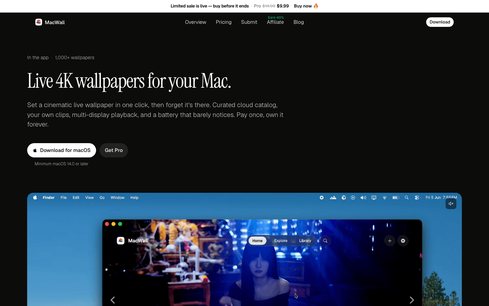

# macwall-web

source for [macwall.app](https://macwall.app), the website for MacWall, a live wallpaper app for the Mac. it covers the marketing pages, wallpaper gallery, blog and docs, pricing, Stripe checkout, and the license endpoints the Mac app talks to.

the Mac app itself is not in here. it lives in a separate private repo.



## running it locally

you need Node 24 and npm 11.

```sh
git clone https://github.com/foundrceo/MacWall-Web.git
cd MacWall-Web
npm install
cp .env.example .env
npm run dev
```

that serves the site on http://localhost:3000 with `next dev`. most pages work with an empty `.env`. checkout, licensing and the admin pages need real keys, see `.env.example` for the names.

production runs on Cloudflare Workers through [vinext](https://github.com/cloudflare/vinext), and a few things only behave the same way there (caching, image resizing, cron triggers). to run that build locally:

```sh
npm run dev:cf      # vite dev server on :3001
npm run preview:cf  # full worker build, served by wrangler dev
```

before pushing:

```sh
npm run lint
npm run typecheck
npm test
```

## layout

- `app/` Next.js App Router pages and API routes
- `components/`, `lib/` UI and shared code
- `worker/` Cloudflare Worker entry, cron dispatch and cache adapter
- `supabase/` migrations and edge functions (license emails, Stripe webhook, etc.)
- `scripts/` build-time generators for the changelog and blog thumbnails
- `tests/` node test runner tests

## deploys

pushing to `main` deploys. Cloudflare Workers Builds runs `npm run build:cf` and then `wrangler deploy`. Supabase edge functions are deployed separately.

GitHub Actions runs a gitleaks scan over the full history plus lint, typecheck and tests on every push and pull request.

## license

the website code is MIT, see [LICENSE](./LICENSE). third-party libraries and fonts keep their own licenses, collected in [THIRD_PARTY_NOTICES.md](./THIRD_PARTY_NOTICES.md).

the MIT license does not cover wallpapers, videos, screenshots, review photos, product icons or trademarks. see [CREDITS.md](./CREDITS.md) for the media policy.

security issues: see [SECURITY.md](./SECURITY.md).
